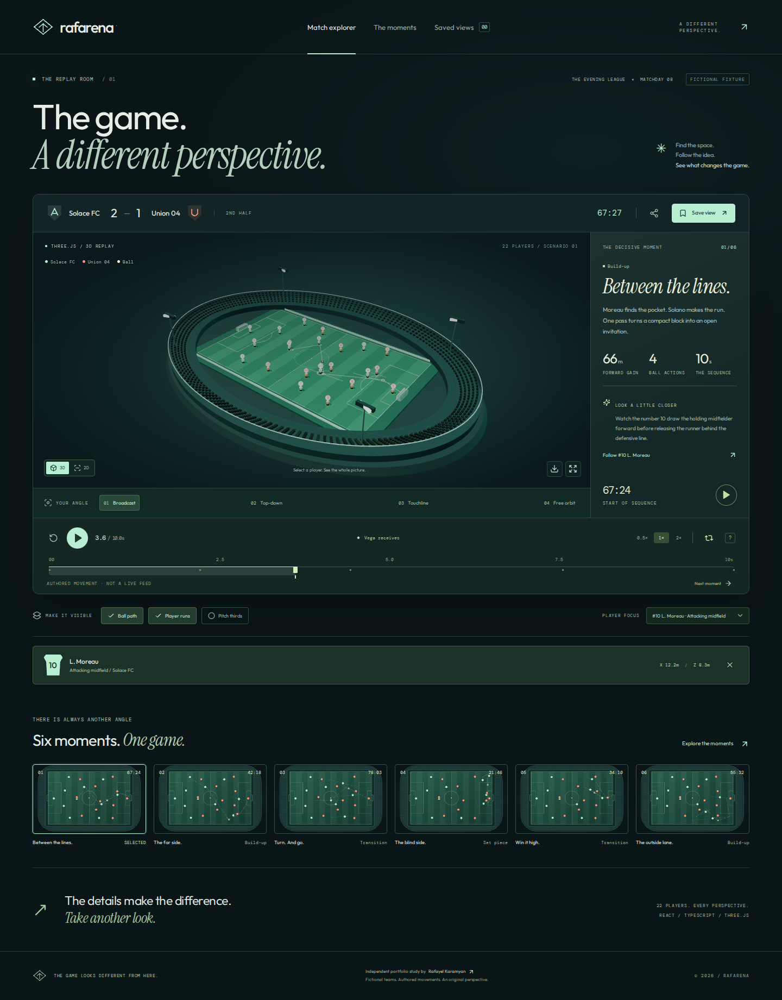

# Rafarena

**A different perspective.** An original football replay explorer built with React, TypeScript and Three.js by **Rafayel Karamyan**.

A procedural stadium, twenty-two players and six authored sequences form an interactive replay room. Explore the shape of a move, change the camera, follow a player and keep an observation with the exact perspective that inspired it.

[Open the live demo](https://rafayelkaramyan.github.io/rafarena/) · [Passing verification and deployment](https://github.com/RafayelKaramyan/rafarena/actions/runs/40019227628)



Actual application capture from the dedicated software-WebGL browser project. The verified release passed 32 unit/integration tests and 41 browser cases across Chromium, Firefox, Pixel 7 emulation and the separate Three.js project. [Release evidence](docs/validation.md) records the exact commit, live checks and limits.

## The experience

- Three.js stadium, pitch markings, goals, players, ball, lights and 1,440 instanced seats, all built in code.
- Six fictional football sequences: a through ball, diagonal switch, counter, short corner, high press and overlap.
- Broadcast, top-down, touchline and free-orbit cameras. Orbit perspectives retain their actual position and target when saved or shared.
- Deterministic replay, scrubbing, pause/play, three speeds, looping and keyboard controls. The match clock follows the selected sequence.
- Ball paths, player runs, pitch thirds, pointer selection and a native player-focus menu.
- Searchable and category-filtered moment library. Browser-local saved views with editable names and observations.
- Shareable snapshot URLs containing camera, time, moment, layers and player focus. Private names and observations stay out of links.
- PNG export of the current 3D canvas or the tactical illustration.
- A complete SVG tactical view when WebGL is unavailable or its context is lost.
- Self-hosted Outfit, Instrument Serif and DM Mono; native dialogs, reduced motion and compact layouts.

## Run locally

Use Node.js 22.12 or later.

```sh
npm ci
npm run dev
```

The development server uses `/`. The production build uses `/rafarena/` for GitHub Pages.

```sh
npm run check
npm run format:check
npm run build
npx playwright install --with-deps chromium firefox
npm run test:e2e
```

Browser tests run against the production build. A dedicated Chromium project uses software WebGL to exercise the actual Three.js renderer; separate Chromium, Firefox and Pixel 7 projects cover the complete application and fallback path. Deployment follows successful verification.

## Engineering

`evaluateFrame(moment, timeMs)` is a pure evaluator shared by the Three.js stage, SVG tactical view and saved-view thumbnails. It evaluates absolute time rather than advancing player positions by frame count. The replay transport publishes render frames separately from its throttled React subscribers.

The WebGL engine is loaded as a separate chunk. It retains scene objects between frames, instances repeated seats, caps pixel density, renders on demand and disposes GPU resources on teardown. Camera changes interpolate unless reduced motion is requested. Rendering and playback pause when the page is hidden.

IndexedDB stores each saved perspective as a separate validated record. Concurrent saves from separate tabs use independent keys and atomic transactions; an observation update replaces only its own record. BroadcastChannel refreshes the other tabs. Write failures keep the form and its values available to retry. Unreadable records are reported and retained.

Read the [architecture](docs/architecture.md), [code walkthrough](docs/walkthrough.md) and [validation record](docs/validation.md).

## Scope and limits

This is an independent portfolio study with fictional teams, players, match statistics and authored movements. It is not live tracking, a physically accurate match simulation, a prediction model or a product affiliated with a club or employer. The forward-gain and action counts derive from the authored keyframes.

Saved perspectives belong to the current browser; there is no account or cloud synchronization. Browser data can be cleared or evicted. Two tabs saving the same existing view use last-committed-write behavior. Snapshot links carry viewing state, not saved notes. PNG export is a still image, with dimensions determined by the renderer; the SVG export is 1920 × 1200. No video, wagering, payments or external sports feed is included.

Software WebGL and mobile emulation do not establish physical-device GPU performance. See the validation record for executed checks and remaining limits.

## Credits

Application source, procedural geometry, graphics and fictional scenarios are authored for this project. React, Three.js, React Router, Zod, Lucide and Fontsource fonts retain their respective licenses. No external image service or runtime account is required.

Copyright © 2026 Rafayel Karamyan.
