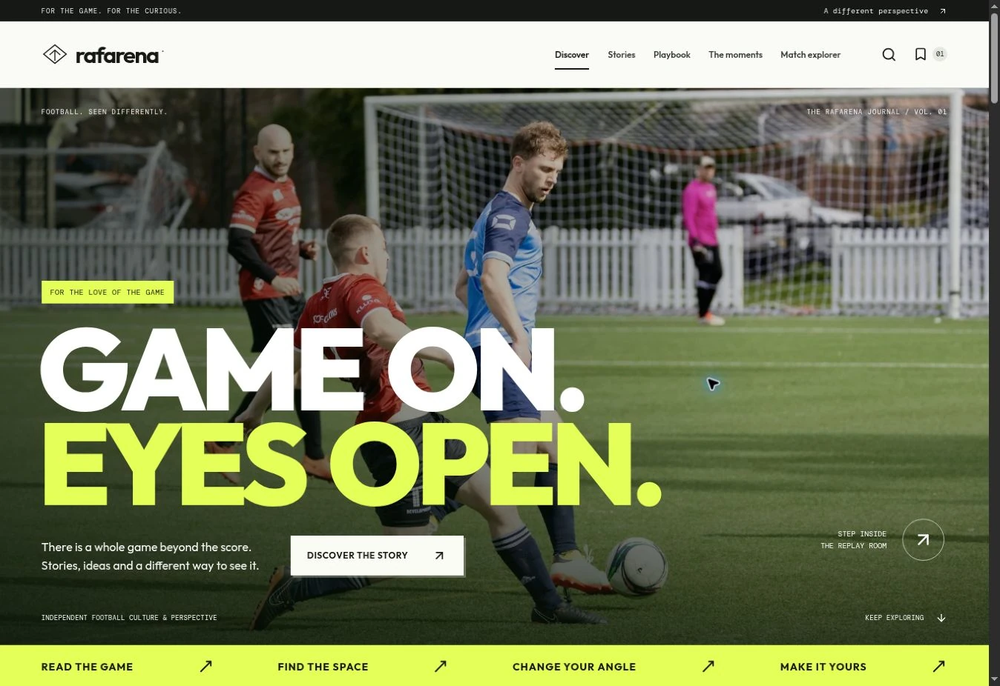

# Rafarena

**Game on. Eyes open.** An original football journal, visual playbook and interactive 3D replay room, built with React, TypeScript and Three.js by **Rafayel Karamyan**.

[Open Rafarena](https://rafayelkaramyan.github.io/rafarena/) · [Verification workflow](https://github.com/RafayelKaramyan/rafarena/actions/runs/40125142444)



A football experience for the curious: read an idea, follow it onto the pitch, change your perspective and keep what you notice. The campaign homepage leads into complete stories, guided studies and a working replay room.

## Explore

| Destination        | Working experience                                                                                                                           |
| ------------------ | -------------------------------------------------------------------------------------------------------------------------------------------- |
| Discover           | A photographic campaign, asymmetric story features, a stadium preview, playbook studies and a football-culture essay.                        |
| Journal            | Four complete articles, category and text filtering, reading-time estimates, in-page contents and links into the relevant scene.             |
| Playbook           | Three visual studies with nine selectable checkpoints. Each diagram and its replay link use the same validated viewing state.                |
| Replay room        | Six authored sequences, 22 players, four camera presets, orbit controls, deterministic replay, player focus and independent analysis layers. |
| Saved perspectives | Browser-local create, edit and remove flows, exact timestamps, camera poses and private observations.                                        |
| Search             | One keyboard-accessible dialog for stories, playbook guides and replay sequences.                                                            |

## Built with a point of view

The editorial site uses self-hosted Outfit, Instrument Serif and DM Mono, large display type, credited photography, a paper-and-ink palette and acid-yellow accents. The replay room retains its focused night palette. Mobile navigation, semantic dialogs, labeled controls and reduced motion are part of the same experience.

Six optimized WebP photographs total 1,253,008 bytes and are bundled locally. The hero is prioritized; secondary images load lazily. The homepage stadium mounts as its section approaches the viewport, then loads the separate WebGL engine. [Photographer credits and sources](docs/photo-credits.md) accompany the images.

The stadium, goals, pitch markings, players, ball, lights and 1,440 instanced seats are built in code. A complete SVG tactical view supports playback, player selection, layers, saving, sharing and PNG export when WebGL is unavailable or its context is lost.

## Engineering

`evaluateFrame(moment, timeMs)` evaluates absolute time and is shared by the 3D scene, tactical diagrams and saved-view thumbnails. The replay clock publishes every render frame separately from its throttled React subscribers.

The engine retains scene objects, instances repeated seats, caps pixel density, renders on demand and disposes GPU resources on teardown. Camera transitions respect reduced motion. Playback pauses on route and visibility changes.

IndexedDB writes one validated perspective per record. Concurrent inserts use independent keys and atomic transactions; BroadcastChannel refreshes other tabs. Write failures keep the form available to retry. Unreadable records are reported and retained.

Snapshot URLs contain moment, time, camera, layers, selected player and the actual orbit pose where applicable. Private titles and observations stay out of links. The canonical replay route is `/explorer`; earlier `/?moment=...` links and existing saved records remain supported.

Read the [architecture](docs/architecture.md), [code walkthrough](docs/walkthrough.md) and [validation record](docs/validation.md).

## Run locally

Use Node.js 22.12 or later.

```sh
npm ci
npm run dev
```

The development server uses `/`; the production build uses `/rafarena/` for GitHub Pages.

```sh
npm run check
npm run format:check
npm run build
npx playwright install --with-deps chromium firefox
npm run test:e2e
```

Browser tests use the production build. Chromium, Firefox and Pixel 7 emulation cover the application and editorial journeys. A separate software-WebGL project exercises the actual Three.js renderer and context-loss recovery. GitHub Pages deploys the tested artifact after successful checks.

The released editorial redesign passed strict TypeScript, formatting, the production build, **36 unit/integration tests and 62 browser cases**, with no retries or skips. The public review verified search-to-guide-to-replay navigation and a saved observation retained across the deployment. [Executed checks and limits](docs/validation.md).

## Scope and credits

This is an independent portfolio project. The real editorial photographs depict independent people and places; their subjects and visible brands are not project partners. The teams, players, statistics and replay movements are fictional and authored. The scenes are illustrations for exploration, rather than live tracking, physical simulation or predictions.

Saved perspectives belong to the current browser and may be cleared or evicted. There is no account, cloud backup or live sports feed. Concurrent edits to the same existing note use last-committed-write behavior. PNG export is a still image; the tactical PNG is 1920 × 1200, and 3D dimensions follow the renderer.

Software WebGL and mobile emulation do not establish physical-device GPU performance. No field Core Web Vitals, commercial outcomes or full accessibility certification are claimed.

Application source, procedural geometry, graphics and editorial copy are created for this project. React, Three.js, React Router, Zod, Lucide and Fontsource fonts retain their respective licenses. Photography is credited separately under the Unsplash License.

Copyright © 2026 Rafayel Karamyan.
